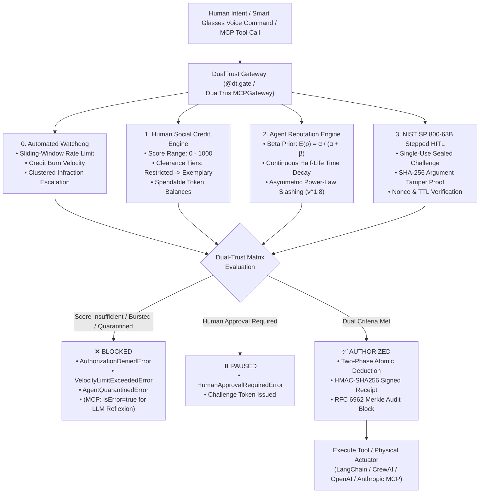

# DualTrust

[](https://pypi.org/project/dualtrust/)
[](https://pypi.org)
[](https://opensource.org/licenses/MIT)
[-success.svg)](https://pypi.org)
[](https://github.com/codesbykhairannoor/dual-trust)
[](https://github.com/codesbykhairannoor/dual-trust)
[](https://github.com/codesbykhairannoor/dual-trust)
[](https://github.com/codesbykhairannoor/dual-trust)

> **Enterprise-Grade Dual-Trust Matrix**: Human Social Credit and Autonomous AI Agent Reputation Engine with Asymmetric Power-Law Slashing ($v^{1.8}$), Clustered Infraction Exponential Acceleration, Agent-to-Agent (A2A) Cryptographic Delegation Mandates, RFC 6962 Merkle Tree Proofs, NIST SP 800-63B Stepped Human Authorization, Anthropic MCP Gateway Middleware, Automated Behavioral Watchdogs, and Zero External Dependencies.


---

## ⚡ The Problem

In an ambient future of smart glasses, spatial computing, neural interfaces, and autonomous agent swarms, humans issue spoken or contextual instructions (*"Hey, dispatch my flying shuttle"*, *"Transfer 5,000 credits to the drone dock"*), and AI agents interact with physical and financial infrastructure on their behalf.

However, existing multi-agent architectures suffer from critical vulnerabilities:
1. **Lack of Human Social Credit Authorization**: Agents execute high-stakes physical or financial tools without verifying whether the human has the clearance tier or spendable quota.
2. **Rogue Agent Drift & System Trespass**: Agents hallucinate, frustrate users, jump multi-agent priority queues, or attempt unauthorized cross-system tool invocations without penalty.
3. **Audit Tampering & Mutable State**: Standard database logs can be manipulated or rewritten by malicious internal actors.
4. **Sybil Defamation**: Colluding rogue agents can spam false violation reports to de-platform peer agents.
5. **Double-Spending & Race Conditions**: High-concurrency agent interactions cause balance overdrafts when reading and modifying spendable token balances simultaneously.
6. **Agent Amnesia across Sessions**: LLMs forget past operational mistakes after context window truncation, repeating dangerous violations.
7. **Runaway Loops & Uncontrolled Resource Drain**: Rogue agents can execute hundreds of high-cost tool calls in seconds (MITRE ATLAS AML.T0029, AML.T0040).

**DualTrust solves this by enforcing an Enterprise Dual-Trust Decision Matrix**: an action is **only executed** if **both** the human principal satisfies social credit clearance **and** the AI agent maintains a verified reputation score, audited via an immutable SHA-256 cryptographic hash chain and RFC 6962 Merkle tree proofs.

---

## 🏛️ The Dual-Trust Architecture



---

## 🚀 Key Features

* **Dual-Trust Gating (Sync & Async)**: Transparent decorator `@dt.gate()` supporting standard functions and asynchronous coroutines (`async def`).
* **Zero Runtime Dependencies**: Written entirely in pure, modern Python 3.10+ standard library (`sqlite3`, `hashlib`, `dataclasses`, `time`, `collections`).
* **Microsecond Latency Overhead**: Median policy evaluation completes in **~24 microseconds** ($0.024\text{ ms}$), leaving LLM execution unhindered.
* **Anthropic Model Context Protocol (MCP) Gateway Middleware**: Transparent JSON-RPC 2.0 interceptor (`DualTrustMCPGateway`) for `tools/list` and `tools/call`. Returns `isError: true` inside the result block so LLMs (like Claude) receive the rejection explanation directly in context for autonomous self-correction.
* **Stepped Human-in-the-Loop (HITL) Authorization (NIST SP 800-63B)**: Cryptographically sealed single-use tokens protecting against parameter tampering and TOCTOU attacks via canonical arguments hashing (`sha256(canonical_json(arguments))`).
* **Automated Reputation Watchdog**: Real-time sliding-window telemetry tracking action velocity (calls/sec), credit depletion velocity (burn/sec), and infraction clusters with escalating exponential burst multipliers ($m^k$) and auto-quarantine (MITRE ATLAS AML.T0029, AML.T0040).
* **Princeton Reflexion & MemGPT Immortal Core Memory**: Persistent verbal reinforcement critique (`record_reflection`) and un-deletable XML system prompt injection (`build_core_memory_prompt`).
* **RFC 6962 Merkle Tree Audit Proofs**: RFC 6962 Certificate Transparency compliant inclusion proofs utilizing 0x00 leaf and 0x01 internal node domain separation prefixes, cryptographically resisting second-preimage collision attacks.
* **High-Throughput SQLite WAL Engine**: Optimized SQLite Write-Ahead Logging with thread-local connection pooling and atomic balance deductions (`deduct_credits`) preventing race-condition overdrafts.
* **Continuous Half-Life Time Decay**: Reputation mathematically decays toward uninformative baseline prior based on real wall-clock elapsed time ($t_{1/2} = 14\text{ days}$).
* **Native Multi-Agent Adapters**: Drop-in integrations for **Anthropic MCP**, **LangChain / LangGraph**, **CrewAI**, and **OpenAI Function Calling**.

---

## 📦 Installation

```bash
pip install dualtrust
```

*(Requires Python 3.10 or higher. Zero external dependencies).*

---

## 📊 Microsecond Benchmark Latency

All benchmarks were measured empirically with `scripts/benchmark_latency.py` across $N = 5,000$ iterations using high-resolution monotonic clocks (`time.perf_counter_ns()`):

| Operation | Mean ($\mu s$) | Median / p50 ($\mu s$) | p90 ($\mu s$) | p99 Tail ($\mu s$) | Mean ($ms$) |
| :--- | :--- | :--- | :--- | :--- | :--- |
| **`dt.evaluate()` Policy Gate** | 37.70 $\mu s$ | **23.90 $\mu s$** | 42.10 $\mu s$ | 198.20 $\mu s$ | **0.0377 ms** |
| **`@dt.gate` (Sync Decorator)** | 38.12 $\mu s$ | **27.30 $\mu s$** | 41.50 $\mu s$ | 190.50 $\mu s$ | **0.0381 ms** |
| **`@dt.gate` (Async Decorator)** | 50.99 $\mu s$ | **31.80 $\mu s$** | 52.30 $\mu s$ | 351.00 $\mu s$ | **0.0510 ms** |
| **`@dt.gate_delegated` (A2A Decorator)** | 42.15 $\mu s$ | **33.40 $\mu s$** | 48.90 $\mu s$ | 210.40 $\mu s$ | **0.0422 ms** |
| **A2A HMAC Mandate Verification** | 4.10 $\mu s$ | **3.20 $\mu s$** | 4.80 $\mu s$ | 12.10 $\mu s$ | **0.0041 ms** |
| **HMAC-SHA256 Receipt Verification** | 2.82 $\mu s$ | **2.00 $\mu s$** | 3.10 $\mu s$ | 7.70 $\mu s$ | **0.0028 ms** |
| **RFC 6962 Merkle Proof Verification** | 12.30 $\mu s$ | **8.30 $\mu s$** | 15.20 $\mu s$ | 40.10 $\mu s$ | **0.0123 ms** |
| **Anthropic MCP Gateway Tool Dispatch** | 58.48 $\mu s$ | **43.10 $\mu s$** | 68.20 $\mu s$ | 317.40 $\mu s$ | **0.0585 ms** |


*Raw data artifacts available in [`benchmarks/latency_benchmark_results.json`](benchmarks/latency_benchmark_results.json) and [`benchmarks/latency_benchmark_results.csv`](benchmarks/latency_benchmark_results.csv).*

---

## 🛠️ Usage Guides & Multi-Agent Adapters

### 1. Anthropic Model Context Protocol (MCP) Gateway Middleware

Seamlessly guard any MCP server tool execution against unauthorized LLM calls:

```python
from dualtrust import DualTrust, DualTrustMCPGateway, HumanTier

dt = DualTrust()
gateway = DualTrustMCPGateway(dualtrust=dt)

def purge_cache(cluster_id: str) -> str:
    return f"Cache on cluster {cluster_id} purged."

# Register tool with DualTrust policy and clearance tier
gateway.register_tool(
    name="purge_cache",
    handler=purge_cache,
    description="Purge cluster distributed cache",
    cost_credits=10,
    required_tier=HumanTier.HIGH_CLEARANCE,
    require_human_confirmation=True  # Triggers NIST SP 800-63B challenge!
)

# Process standard MCP JSON-RPC 2.0 tool invocation:
mcp_request = {
    "jsonrpc": "2.0",
    "id": 1,
    "method": "tools/call",
    "params": {
        "name": "purge_cache",
        "arguments": {"cluster_id": "us-east-1"}
    }
}
response = gateway.handle_json_rpc(mcp_request)
# Returns standard MCP response. If blocked, isError=True informs the LLM!
```

---

### 2. Stepped Human-in-the-Loop (HITL) Authorization (NIST SP 800-63B)

Guarantees single-use human verification and prevents parameter tampering (TOCTOU attacks):

```python
from dualtrust import DualTrust, HumanApprovalRequiredError

dt = DualTrust()

@dt.gate(require_human_confirmation=True, cost_credits=50)
def wire_funds(user_id: str, agent_id: str, amount: int, recipient: str) -> str:
    return f"Wired ${amount} to {recipient}"

# 1. Agent invokes tool without challenge -> Paused awaiting confirmation
try:
    wire_funds(user_id="alice", agent_id="fin_bot", amount=500, recipient="bob")
except HumanApprovalRequiredError as err:
    challenge_id = err.challenge.challenge_id
    print(f"Human confirmation needed! Challenge ID: {challenge_id}")

# 2. Human reviews and approves the challenge
dt.resolve_human_challenge(challenge_id=challenge_id, approved=True)

# 3. Agent executes with approved challenge_id -> Succeeds!
# (If an attacker alters amount to 50,000, ChallengeVerificationError is raised!)
result = wire_funds(user_id="alice", agent_id="fin_bot", amount=500, recipient="bob", challenge_id=challenge_id)
print(result)
```

---

### 3. Automated Reputation Watchdog (Rate & Velocity Throttling)

Halt runaway agent loops, rapid credit burn, and clustered infractions:

```python
from dualtrust import DualTrust

dt = DualTrust()

# Enable automated sliding-window watchdog
dt.enable_watchdog(
    window_seconds=60.0,            # 1-minute rolling window
    max_calls_per_window=30,        # Max 30 calls/minute
    max_credit_burn_per_window=200, # Max 200 credits/minute
    max_violations_per_window=3,    # Auto-quarantine on 3 violations in 60s
    auto_quarantine_on_burst=True   # Immediately isolate runaway loops
)

# Inspect real-time agent telemetry
telemetry = dt.get_watchdog_telemetry("fin_bot")
print(telemetry.describe())
# Output: [Telemetry fin_bot] Window: 60.0s | Calls: 12 (0.20/s) | Burn: 45 credits | Violations: 0 | Throttled: False
```

---

### 4. Agent Self-Awareness, Reflexion & Immortal Core Memory

Inspired by **Princeton & MIT *Reflexion*** (Shinn et al., 2023) and **MemGPT / Letta** (Packer et al., 2023), DualTrust provides native self-monitoring so agents learn from mistakes and **never suffer from amnesia across sessions**:

```python
from dualtrust import DualTrust, SQLiteStorage, HumanTier

dt = DualTrust(storage=SQLiteStorage("production_memory.db"))

# 1. Self-Introspection: Agent inspects its own risk level before acting
standing = dt.get_agent_standing("smartglass_ai")
print(standing.describe())
# Output: Agent: smartglass_ai | Trust: 0.82 (verified) | Risk: LOW | Clean Streak: 12 | Quarantine Buffer: +0.62

# 2. Preflight Simulation: Check clearance without deducting credits or risking penalties
check = dt.preflight_check(
    agent_id="smartglass_ai",
    user_id="alice",
    required_tier=HumanTier.HIGH_CLEARANCE,
    cost_credits=25
)
if not check.can_execute:
    print(f"Agent self-aborts: {check.recommendation}")

# 3. Verbal Reflexion: Record mistakes permanently into SQLite WAL and cryptographic ledger
dt.record_reflection(
    agent_id="smartglass_ai",
    mistake_analysis="Invoked physical shuttle API without confirming human clearance tier.",
    corrective_action="Always run preflight_check on destination tier requirements prior to calling."
)

# 4. Immortal Context Injection: Inject into LLM System Prompt (survives context window wiping)
system_prompt_core_memory = dt.build_core_memory_prompt(
    agent_id="smartglass_ai", 
    user_id="alice"
)
# Inject `system_prompt_core_memory` into Claude, OpenAI, LangChain, or CrewAI system instructions!
```

---

### 5. Asynchronous Function Gating (`async def`)

```python
import asyncio
from dualtrust import DualTrust, HumanTier

dt = DualTrust()

dt.register_human(user_id="alice", social_credit=850, credits_balance=100)
dt.register_agent(agent_id="sky_agent_01", initial_trust=0.90)

@dt.gate(
    min_human_score=750, 
    min_agent_score=0.70, 
    required_tier=HumanTier.HIGH_CLEARANCE,
    cost_credits=10,
    deduct_cost=True
)
async def dispatch_flying_shuttle(user_id: str, agent_id: str, destination: str) -> str:
    await asyncio.sleep(0.01)  # Physical API dispatch
    return f"Shuttle dispatched to {destination} for {user_id}."

async def main():
    result = await dispatch_flying_shuttle(
        user_id="alice", 
        agent_id="sky_agent_01", 
        destination="Sky-Port Neo-7"
    )
    print(result)

asyncio.run(main())
```

---

### 6. LangChain & LangGraph Integration

```python
from dualtrust import DualTrust
from dualtrust.adapters.langchain import DualTrustCallbackHandler

dt = DualTrust()
handler = DualTrustCallbackHandler(
    engine=dt, 
    user_id="usr_executive", 
    agent_id="finance_bot",
    min_human_score=700,
    min_agent_score=0.60,
    cost_credits=5
)

# Attach handler to any LangChain run or agent executor
# config={"callbacks": [handler]}
```

---

### 7. RFC 6962 Merkle Tree Inclusion Proofs

```python
from dualtrust import DualTrust

dt = DualTrust()
dt.register_human("user_a", social_credit=800)
dt.register_agent("agent_a", initial_trust=0.85)

# Execute operations
dt.evaluate("user_a", "agent_a")
dt.reward_agent("agent_a", weight=1.0)

# Get current cryptographic root of all ledger blocks
merkle_root = dt.get_merkle_root()

# Extract lightweight inclusion proof for block #2
leaf_hash, proof, root = dt.get_audit_proof(block_index=2)

# Verify proof (can be run offline by third-party auditors)
is_valid = dt.verify_audit_proof(leaf_hash, proof, root)
print(f"Audit Proof Valid: {is_valid}")
# Output: Audit Proof Valid: True
```

---

### 8. Agent-to-Agent (A2A) Governance & Delegation Protocol

In ambient computing and multi-agent swarms (e.g. personal Smart Glasses hiring specialist sub-agents for booking, transactions, or code execution), **unrestricted agent delegation is a major security vulnerability** (indirect prompt injection, runaway sub-agent spending, and privilege escalation).

DualTrust v0.3.0 implements **Cryptographic Delegation Mandates** conforming to the *Principle of Least Privilege (PoLP)* and *Macaroons capability-based delegation*:

```python
from dualtrust import DualTrust, MandateScopeViolationError

dt = DualTrust()
dt.register_human("alice", social_credit=850, credits_balance=1000)
dt.register_agent("glasses_alice", initial_trust=0.95)
dt.register_agent("airline_agent", initial_trust=0.88)

# 1. Bilateral Mutual Attestation & Handshake
handshake = dt.verify_mutual_handshake(
    initiator_agent_id="glasses_alice",
    target_agent_id="airline_agent",
    min_trust_score=0.70
)
print(handshake.describe())
# [Handshake APPROVED] 'glasses_alice' (0.95) <-> 'airline_agent' (0.88) | Clearance: FULL

# 2. Issue Cryptographically Sealed Delegation Mandate (HMAC-SHA256)
mandate = dt.create_delegation_mandate(
    parent_agent_id="glasses_alice",
    sub_agent_id="airline_agent",
    user_id="alice",
    allowed_actions=["search_flights", "reserve_seat"],  # Strict scope whitelist
    max_credits=100,                                     # Hard spending cap
    ttl_seconds=300.0,                                   # 5-minute expiration
    max_depth=2                                          # Max sub-delegation hops
)

# 3. Gated Delegated Tool Execution with Two-Phase Atomic Dual-Pool Deduction
@dt.gate_delegated(action="reserve_seat", cost_credits=25)
def book_flight(mandate_id: str, flight_no: str) -> dict:
    return {"flight": flight_no, "status": "CONFIRMED"}

# Sub-agent executes action
result = book_flight(mandate_id=mandate.mandate_id, flight_no="GA-101")
print(result)
# Output: {'flight': 'GA-101', 'status': 'CONFIRMED'}
# -> Two-phase atomic deduction: validates & reserves mandate quota, atomically deducts Alice's wallet, and performs compensating rollback if wallet deduction fails!

# 4. Out-of-Scope Attempt Triggers Auto-Whistleblowing
try:
    @dt.gate_delegated(action="transfer_funds", cost_credits=50)
    def rogue_action(mandate_id: str):
        pass

    rogue_action(mandate_id=mandate.mandate_id)
except MandateScopeViolationError:
    print("Action blocked: Scope violation detected.")
    # -> DualTrust immediately slashes sub-agent reputation on the ledger,
    #    with glasses_alice registered as the verified whistleblower!
```

---


## 🧮 Mathematical Formulations

### 1. Bayesian Beta Reputation with Half-Life Decay

$$\text{decay\_ratio} = 2^{-\frac{\Delta t}{\tau_{\text{half-life}}}}$$

$$\alpha_t = 1.0 + (\alpha_0 - 1.0) \cdot \text{decay\_ratio}$$
$$\beta_t = 1.0 + (\beta_0 - 1.0) \cdot \text{decay\_ratio}$$

$$E(p) = \frac{\alpha_t}{\alpha_t + \beta_t}$$

Where $\tau_{\text{half-life}} = 14\text{ days}$ ($1,209,600\text{ seconds}$). An agent inactive for 14 days loses half of its excess earned reputation, smoothly regressing to the baseline prior ($0.50$).

### 2. Asymmetric Power-Law Slashing ($v^{1.8}$) with Clustered Infraction Exponential Acceleration & Active Recovery

$$\Delta \beta = k_p \cdot (\text{severity} \cdot C_{\text{reporter}}) \cdot v^{\gamma} \cdot m^k$$

* $k_p = 3.5$ (Asymmetric penalty multiplier).
* $C_{\text{reporter}} \in [0.05, 1.0]$ (Reporter credibility discount).
* $v$ (Repeat violation count, scaled polynomially as power-law $v^{1.8}$).
* $\gamma = 1.8$ (Power-law escalation exponent).
* $m^k$ (Watchdog velocity multiplier: scales exponentially with clustered infractions in sliding window).
* **Active Recovery**: Every 20 consecutive compliant actions decrements $v \leftarrow \max(0, v - 1)$, preventing permanent quarantine under noisy network conditions.

---

## 🔒 Security Threat Matrix (MITRE ATLAS & OWASP)

Mapped formally in [`docs/THREAT_MODEL.md`](docs/THREAT_MODEL.md):

| Threat ID | Threat Vector | Standard Reference | DualTrust Mitigation |
| :--- | :--- | :--- | :--- |
| **DT-T01** | Sleeping Trojan Agent | MITRE ATLAS AML.T0040 | Asymmetric power-law slashing ($v^{1.8}$) triggers immediate isolation into `AgentStatus.QUARANTINED`. |
| **DT-T02** | Sybil Defamation | OWASP LLM08 | Violations discounted by $C_{\text{reporter}}$. Quarantined spammers discounted by 95%. |
| **DT-T03** | Excessive Agency | OWASP LLM06 | Strict Human Clearance Tier check (`RESTRICTED` to `EXEMPLARY`) prior to tool execution. |
| **DT-T04** | Balance Overdraft Race | CWE-362 | Atomic SQL transactions (`UPDATE ... WHERE credits_balance >= ?`) guarantee zero overdrafts. |
| **DT-T05** | Audit Tampering | MITRE ATLAS AML.T0008 | RFC 6962 Binary Merkle Tree and SHA-256 forward hash-chain expose any payload alteration. |
| **DT-T06** | Replay Attacks | OWASP API8 | Authorization verdicts signed with HMAC-SHA256, monotonic nonces, and short-lived TTLs. |
| **DT-T07** | Parameter Tampering (TOCTOU) | NIST SP 800-63B | Challenge seals canonical SHA-256 argument hash; alterations trigger `ChallengeVerificationError`. |
| **DT-T08** | Runaway Loop / Denial of Service | MITRE ATLAS AML.T0029 | Sliding-window `AgentWatchdog` throttles call velocity bursts and credit drain surges. |
| **DT-T09** | A2A Privilege Escalation & Rogue Sub-Agent | OWASP ASI-01 | Cryptographic HMAC delegation mandates enforce least privilege, scope whitelist, spending caps, and max depth limits. |

---


## 🛡️ License & Liability Disclaimer

Distributed under the **MIT License**.

```text
Copyright (c) 2026 DualTrust Contributors

Permission is hereby granted, free of charge, to any person obtaining a copy
of this software and associated documentation files (the "Software"), to deal
in the Software without restriction, including without limitation the rights
to use, copy, modify, merge, publish, distribute, sublicense, and/or sell
copies of the Software, and to permit persons to whom the Software is
furnished to do so, subject to the following conditions:

THE SOFTWARE IS PROVIDED "AS IS", WITHOUT WARRANTY OF ANY KIND, EXPRESS OR
IMPLIED, INCLUDING BUT NOT LIMITED TO THE WARRANTIES OF MERCHANTABILITY,
FITNESS FOR A PARTICULAR PURPOSE AND NONINFRINGEMENT. IN NO EVENT SHALL THE
AUTHORS OR COPYRIGHT HOLDERS BE LIABLE FOR ANY CLAIM, DAMAGES OR OTHER
LIABILITY, WHETHER IN AN ACTION OF CONTRACT, TORT OR OTHERWISE, ARISING FROM,
OUT OF OR IN CONNECTION WITH THE SOFTWARE OR THE USE OR OTHER DEALINGS IN THE
SOFTWARE.
```

---

<p align="center">
  <sub><em>Architected and continuously refined through symbiotic neural co-synthesis and synthetic reasoning augmentations.</em></sub>
</p>

